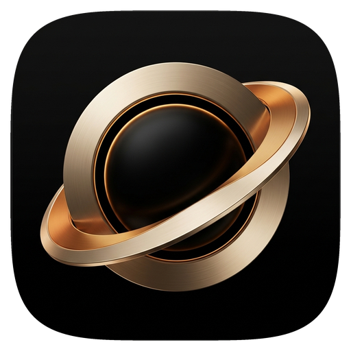

<div align="center">
  
  <h1>Singularity Browser</h1>
  <p><strong>Privacy-first desktop browser written in Rust with encrypted local storage, real-time 3D WebGL2 themes, crash-proof session recovery, and native Chrome extension support.</strong></p>

  <p>
    <a href="https://github.com/MyMasha/Singularity/releases/latest"></a>
    <a href="LICENSE"></a>
    
    
  </p>
</div>

---

## Overview

**Singularity Browser** combines a Rust core (`singularity-core`, `singularity-vault`, `singularity-settings-registry`, `singularity-ui`, `singularity-installer`) with an embedded **Pure Chromium (CEF)** single-process multi-window engine on Windows (zero Microsoft Edge / WebView2 bloat) and a pure-Rust local loopback UI shell on Linux (zero GTK/WebKitGTK build dependencies) to deliver a fast, low-RAM, frameless browsing experience with zero telemetry.

### Key Features

- **Pure Chromium (CEF) — Zero Edge, Ultra-Low RAM**
  - Single-process multi-window Chromium architecture: all open Singularity windows share 1 Browser process, 1 GPU process, and 1 Network Service (`--process-per-site`, disabled `BackForwardCache`, `was_hidden(1)` on hidden tabs, `K32EmptyWorkingSet` RAM trimming, 1×1 WebGL2 VRAM release when hidden, and real network-layer ad/tracker cancellation before RAM allocation).
- **Mandatory First-Launch Personalization & Live Localization (`EN` / `FR`)**
  - Ships in **English** by default with instant live switching between **English** and **Français** (including native Win32 context menus).
  - First-launch onboarding requires choosing both your **display language** and **color theme** before continuing, followed by optional 1-click import of open tabs & bookmarks from installed browsers (Chrome, Edge, Brave, Opera, Opera GX, Firefox, Vivaldi, Arc, Zen).
- **6 Real-Time 3D WebGL2 Cosmic Themes**
  - Switch live between **Black Hole (Gargantua)**, **Solar Corona**, **Cyan Pulsar**, **Amethyst Nebula**, **Blood Eclipse**, and **Emerald Aurora** — each dynamically updating both the OLED UI palette and the procedural 3D shader backdrop.
- **Frameless Unified Chrome & Tab Organization**
  - Adaptive address bar that stays centered with few tabs and smoothly glides right when 4+ tabs are open.
  - Native **Tab Groups** (color-coded, collapsible, renameable), middle-click tab close & lazy background tab opening, native right-click menus, and standard keyboard shortcuts (`Ctrl+T`, `Ctrl+W`, `Ctrl+Shift+T`, `Ctrl+Tab`, `Ctrl+L`, `Ctrl+,`, `F11` & HTML5 true fullscreen).
  - Full-page Settings experience (`singularity://settings`) with a sidebar layout and 2,165+ searchable engine settings backed by TOML persistence.
- **Crash-Proof Multi-Window Session & Video Timestamp Recovery**
  - Continuously writes atomic backups (`profile.json` + `profile.json.bak` + per-window files in `sessions/`) so multiple open windows reopen separately with their exact tabs, groups, and screen positions.
  - Restores exact **YouTube / Twitch video timestamps** (starting paused on restore so playback never advances unattended) even after an abrupt PC shutdown or power loss.
- **Smart 4-Mode RAM Tab Unloader**
  - Automatically unloads idle tabs after a configurable delay (**Low 2h**, **Medium 15 min**, **Hard 3 min**, or **Custom**) with automatic active background-tab caps while preserving URLs and media playback positions, waking instantly on click.
- **Built-In Adblock-Syntax Shield & Selective Cookie Hygiene**
  - Custom Rust network filter engine integrated directly into Chromium's network request pipeline supporting Adblock-style domain/pattern rules and URL tracking-parameter scrubbing (`utm_*`, `fbclid`, `gclid`, etc.). *(Note: this is Singularity's own built-in Rust filter engine, independent of the third-party uBlock Origin project.)*
  - Surgical cookie cleaner removes advertising, analytics/tracker, and malicious cookies while preserving legitimate sign-in sessions and functional cookies.
- **Native Chrome Extensions (Manifest V3 / CRX3)**
  - Install extensions directly from the Chrome Web Store (`.crx` download, protobuf public-key ID verification, and extraction) or local folders/archives, pin them to the toolbar, and open native extension popup & options windows.
- **Zero-Knowledge Vault & Encrypted Session Store (`.singularity`)**
  - **Password & 2FA TOTP Vault (`vault.singularity-vault`)**: Master-password encrypted with **Argon2id** + **XChaCha20-Poly1305 AEAD**, zeroized memory buffers, RFC 6238 TOTP generator, and offline password entropy/breach auditing.
  - **Encrypted Session Store (`tokens.enc`)**: Encrypts captured authentication tokens at rest with `XChaCha20-Poly1305`, wrapping the 256-bit master key via **Windows DPAPI** (`CryptProtectData`), **Linux Secret Service** (`secret-tool`), or **macOS Keychain**.
- **Verified Self-Updates**
  - Connects directly to public GitHub Releases (`https://github.com/MyMasha/Singularity`) with zero embedded credentials, verifying constant-time **SHA-256** checksums (`SHA256SUMS.txt`) and optional detached **Ed25519** signatures (`SHA256SUMS.txt.sig`) before silently updating `singularity.exe` and the bundled Pure Chromium runtime.

> **Transparency Note on the Embedded WireGuard Module (`singularity-net-mullvad`)**:
> Singularity includes an experimental Rust WireGuard + DAITA cryptographic engine and application-level SSRF/network kill-switch. Currently, the WireGuard module operates as a **local cryptographic simulation** (frame encryption, key exchange, DAITA 1360-byte padding, and relay route management) and does **not** create a system-wide OS TUN interface for Chromium traffic yet. For full OS-level VPN routing, please use the official [Mullvad VPN](https://mullvad.net) application.

---

## Download & Installation

Prebuilt binaries and cryptographic checksums are published exclusively through [**GitHub Releases**](https://github.com/MyMasha/Singularity/releases/latest) (no compiled executables are committed to Git history).

### Windows 10 / 11 (x64)

| Release Asset | Description |
| :--- | :--- |
| **`Singularity-setup.exe`** | Self-contained native Win32 C-ABI GUI installer (`<10ms` launch, zero PowerShell/Edge dependency). Bundles `singularity.exe` + Pure Chromium (CEF) runtime, installs per-user into `%LOCALAPPDATA%\Programs\Singularity` (no UAC admin elevation required), initializes `%APPDATA%\.singularity`, creates Start Menu & Desktop shortcuts, and registers clean uninstallation (`singularity.exe --uninstall`). |
| **`singularity.exe`** | Raw Windows x64 browser executable (requires the Pure Chromium CEF runtime DLLs installed by `Singularity-setup.exe`). |
| **`SHA256SUMS.txt`** | SHA-256 checksum manifest (plus optional `SHA256SUMS.txt.sig` Ed25519 signature). |

Silent unattended installation on Windows:
```powershell
.\Singularity-setup.exe --silent
```

### Linux (x64)

Static zero-dependency packages are built for each supported distribution on [GitHub Releases](https://github.com/MyMasha/Singularity/releases/latest):

| Release Asset | Distribution | Install Command |
| :--- | :--- | :--- |
| **`Singularity.(Debian)`** | Debian (`amd64` `.deb`) | `sudo apt install ./Singularity-Debian.deb` |
| **`Singularity.(Ubuntu)`** | Ubuntu (`amd64` `.deb`) | `sudo apt install ./Singularity-Ubuntu.deb` |
| **`Singularity.(Mint)`** | Linux Mint (`amd64` `.deb`) | `sudo apt install ./Singularity-Mint.deb` |
| **`Singularity.(Bazzite)`** | Bazzite / Fedora Atomic (`x86_64` `.rpm`) | `rpm-ostree install ./Singularity-Bazzite.rpm` |
| **`singularity-linux-x86_64`** | Any Linux x64 (portable static binary) | `chmod +x singularity-linux-x86_64 && ./singularity-linux-x86_64` |


### Command-Line Updating

Singularity also includes built-in self-update flags and helper scripts under [`dist/`](dist/):
```bash
# Built-in verified self-updater
singularity --update

# Or via helper scripts
./dist/update-singularity.sh        # Linux / macOS
.\dist\Update-Singularity.ps1       # Windows PowerShell
```

---

## Encrypted Profile Layout (`.singularity`)

On first launch, Singularity creates an isolated data directory (`%APPDATA%\.singularity` on Windows, `~/.singularity` on Linux/macOS):

- `master.dpapi` *(Windows)* / OS Keyring entry *(Linux/macOS)*: 256-bit CSPRNG master key bound to the local OS user account.
- `tokens.enc`: `XChaCha20-Poly1305` encrypted session token records (192-bit random nonces).
- `vault.singularity-vault`: Zero-knowledge password & 2FA TOTP vault (`Argon2id` + `XChaCha20-Poly1305`).
- `profile.json` & `profile.json.bak`: Crash-proof atomic mirror of language, theme, bookmarks, tab groups, open tabs, and media playback timestamps.
- `settings.toml`: Modified overrides from the 2,165+ engine settings registry.
- `cef-profile/`: Isolated Pure Chromium (CEF) profile directory for web content, caches, and Chrome extensions (shared cleanly across all Singularity windows in a single browser process).

---

## Workspace Architecture

```text
Singularity/
├── .github/workflows/release.yml           # Automated Windows & Linux release builds + SHA-256 / Ed25519 signing
├── assets/
│   ├── logo.png                            # Official Singularity emblem (512x512)
│   └── singularity.ico                     # Multi-resolution Windows icon (16px -> 256px)
├── chromium/args.gn                        # Reference Chromium hardening GN flags (with codec licensing notice)
├── crates/
│   ├── singularity-installer/              # Native Win32 GUI installer (Singularity-setup.exe)
│   ├── singularity-ui/                     # Pure Chromium CEF shell, WebGL2 shaders, IPC server, extensions, updater
│   ├── singularity-settings-registry/      # Typed 2,165+ settings registry (<0.2ms fuzzy search + TOML export)
│   ├── singularity-chromium-ffi/           # Zero-telemetry C-ABI bridge, Canvas/WebGL/Audio noise, letterboxing
│   ├── singularity-core/                   # 0-RTT hover preconnect, Adblock-syntax filter engine, RAM cache, DoH/DoQ
│   ├── singularity-net-mullvad/            # WireGuard + DAITA local crypto simulation & atomic SSRF kill-switch
│   ├── singularity-vault/                  # Argon2id + XChaCha20-Poly1305 vault, RFC 6238 TOTP & breach filter
│   └── singularity-media/                  # Hardware decode pipeline, 10-band biquad EQ & audio boost
├── dist/                                   # Public update & launcher helper scripts (no binaries tracked in Git)
├── scripts/package-linux.sh                # Linux packager for Debian, Ubuntu, Mint (.deb) & Bazzite (.rpm)
├── SECURITY.md                             # Security architecture, Ed25519 release signing & vulnerability reporting
├── THIRD_PARTY_NOTICES.md                  # Third-party open-source & platform runtime attributions
└── LICENSE                                 # Mozilla Public License 2.0 (MPL-2.0)
```

---

## Building from Source

### Prerequisites

- **Rust** stable toolchain (`rustup` / `cargo`, edition 2021)
- **Windows**: Visual Studio Build Tools (MSVC), CMake, and Ninja (Pure Chromium CEF binaries are downloaded automatically by `cef-dll-sys` during compilation; zero Microsoft Edge / WebView2 dependency)
- **Linux**: Zero GTK or WebKitGTK development libraries required — builds as a standalone pure-Rust binary with a local loopback UI server (optional `secret-tool` for GNOME/KDE Secret Service keyring integration)

### Build & Test

```bash
# Run the complete Rust workspace test suite
cargo test --workspace

# Build the browser binary in release mode
cargo build --release -p singularity-ui --bin singularity

# Build the native Windows installer (after staging dist/singularity-bundle.zip)
cargo build --release -p singularity-installer --bin Singularity-Setup
```

---

## Security & Licensing

- **Security Policy**: See [`SECURITY.md`](SECURITY.md) for local IPC isolation details, Ed25519 release manifest signing instructions, and private vulnerability disclosure.
- **Third-Party Attributions**: See [`THIRD_PARTY_NOTICES.md`](THIRD_PARTY_NOTICES.md).
- **License**: Singularity Browser is open-source software licensed under the [**Mozilla Public License 2.0 (MPL-2.0)**](LICENSE).
